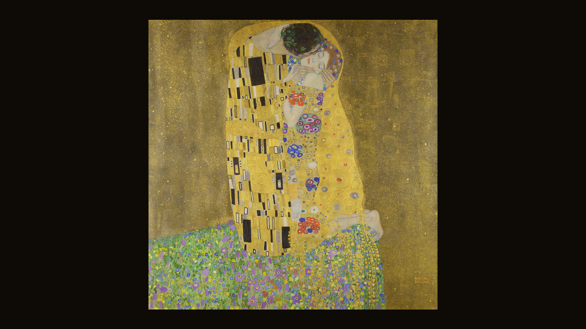
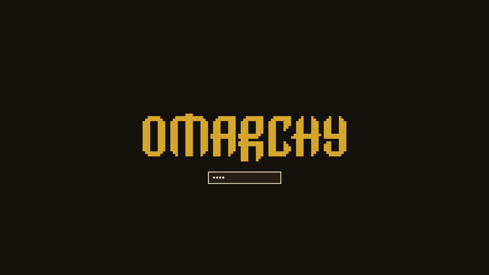

# Klimt — an Omarchy theme

A dark theme in gold leaf on black, with emerald, ruby, turquoise and lapis mosaic accents — from Gustav Klimt's Golden Period.



## Install

```bash
omarchy theme install https://github.com/Van-Ausburn/omarchy-klimt-theme
omarchy theme set klimt
```

Cycle through the paintings with `omarchy theme bg next`.

## Palette

Gold-leaf accent on lacquer black, ivory text, jewel-tone ANSI colors from the mosaics of *The Kiss* and *Adele Bloch-Bauer I*.

| Role | Color |
|---|---|
| `accent` | `#d4a62a` |
| `selection` | `#3a2f18` |
| `muted` | `#5c4e33` |
| `background` | `#14110c` |
| `dark_background` | `#0e0b07` |
| `darker_background` | `#080604` |
| `lighter_background` | `#241e14` |
| `foreground` | `#efe2c0` |
| `dark_foreground` | `#8a7d60` |
| `light_foreground` | `#dccb9e` |
| `bright_foreground` | `#fff4d6` |
| `red` | `#d2493a` |
| `yellow` | `#e3b53a` |
| `orange` | `#d9822b` |
| `green` | `#3fa36b` |
| `cyan` | `#4fb3a5` |
| `blue` | `#5b7fc7` |
| `magenta` | `#c06a9a` |
| `brown` | `#9a6a2a` |
| `bright_red` | `#ef6f5f` |
| `bright_yellow` | `#f5d062` |
| `bright_green` | `#66c48c` |
| `bright_cyan` | `#78d1c4` |
| `bright_blue` | `#86a3e0` |
| `bright_magenta` | `#db8fbb` |

## Boot & login screen

The theme ships an `unlock.png` logo in its accent color. To use it for the Plymouth boot screen and SDDM login:

```bash
omarchy plymouth set by theme klimt
```



## Wallpapers

All paintings are in the **public domain** and were sourced from Wikimedia Commons:

- [The Kiss](https://commons.wikimedia.org/wiki/File:The_Kiss_-_Gustav_Klimt_-_Google_Cultural_Institute.jpg) — Gustav Klimt, 1907–08
- [Portrait of Adele Bloch-Bauer I](https://commons.wikimedia.org/wiki/File:Gustav_Klimt_-_Porträt_der_Adele_Bloch-Bauer_I_(1907).jpg) — Gustav Klimt, 1907
- [Beethoven Frieze (middle wall)](https://commons.wikimedia.org/wiki/File:Klimt_-_Beethovenfries_-_Mittelwand.jpg) — Gustav Klimt, 1902
- [Beethoven Frieze: Longing for Happiness](https://commons.wikimedia.org/wiki/File:Gustav_Klimt_-_Beethovenfries,_"Die_Sehnsucht_nach_dem_Glück"_(nach_Richard_Wagners_Interpretation_der_IX._Sinfonie_von_Ludwig_van_Beethoven)_-_5987_-_Österreichische_Galerie_Belvedere.jpg) — Gustav Klimt, 1902

## License

Theme files (palette, icon choice, logo recolor) are MIT licensed — see [LICENSE](LICENSE).
The paintings are public domain. The Omarchy logo belongs to the Omarchy project.
